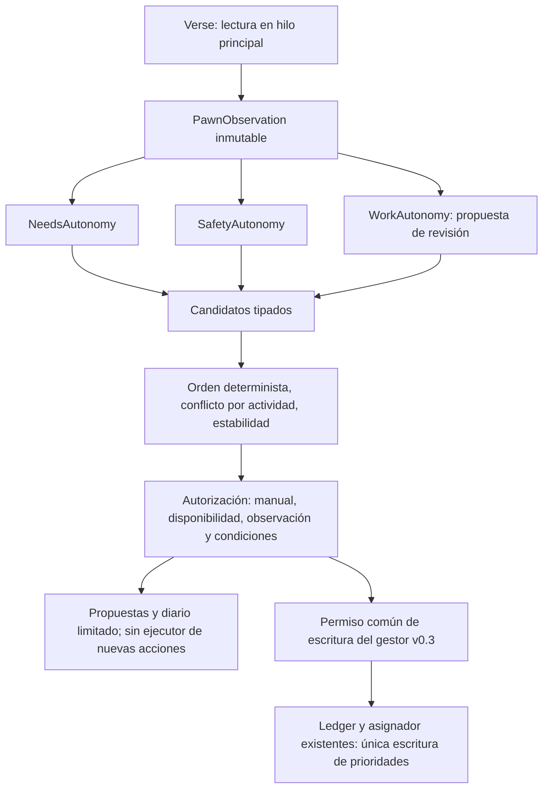

# Autonomous Director v0.4 experimental

Base: v0.3 `c95486c7d8956635e7bab22b3b20321043cc3807`. Desarrollo exclusivo en `feat/autonomous-colonists-1.7`. El commit posterior `23b205a` ya contenía el workflow de publicación de v0.3; no se modifica. No hay cambios de master, APK, Gradle, Waylith o motor.

## Componentes y autoridad

`AutonomousCoordinatorComponent` es un nuevo GameComponent, separado del gestor existente `AutonomyGameComponent`. Lee Verse, configura y guarda el núcleo `AutonomousDecisionCoordinator`. La clase histórica **`AutonomousColonists.AutonomyDirector : MapComponent` permanece idéntica**, incluido su nombre y herencia; su SHA-256 coincide con v0.3. Sigue importando partidas v0.2 al registro del gestor, sin escribir durante Scribe.

El núcleo no referencia Verse ni Unity. Sus entradas son valores; sus módulos solo pueden producir candidatos. La misma entrada y memoria producen la misma salida, independientemente del orden de colonos y de registro de módulos. Salud y ropa tienen identificadores reservados y el contrato `IAutonomyModule`; todavía no hay módulos activos que prescriban acciones de Health/Apparel.

Cada candidato contiene ID del colono y mapa, necesidad, prioridad, urgencia, motivo, origen, acción, condiciones requeridas/satisfechas, recurso y autorización. La memoria mantiene niveles e incumbencia; el diario circular conserva como máximo 64 candidatos con su resultado. Las propuestas contabilizan también conflictos y vetos, no solo ganadores. Los contadores y el último motivo son diagnósticos de sesión y se reinician al cargar.

## Las seis etapas

1. **Observar:** una lectura por colono vivo desplegado, en el hilo del juego; señales globales una vez por mapa. No se recorren los objetos del mapa, reservas ni rutas. Las exclusiones solo aportan identidad para invalidar caché.
2. **Evaluar:** clasificar comida/descanso con umbrales y recuperación con margen de 5 puntos porcentuales. Lecturas ausentes, fuera de rango, NaN o infinitas no se convierten en necesidades inventadas.
3. **Proponer:** Needs genera comer/descansar; Safety propone refugio ante señales de peligro/incendio y registra fin de emergencia; Work propone revisar cobertura ante necesidades importantes, sin forzar un recálculo adicional.
4. **Resolver:** prioridad descendente, urgencia descendente, módulo/acción/motivo como desempate estable. Un ganador por actividad y colono. Se conserva la alternativa vigente si sigue presente y la mejora es inferior al margen. Durante estabilidad, solo una escalada de urgencia o mejora suficiente puede sustituirla.
5. **Autorizar/ejecutar:** una orden forzada o reclutamiento veta toda propuesta, aun crítica y en Avanzado. Incapacidad/estado mental también vetan. Observación deniega ejecución. Las alternativas deben conocerse para cualquier ejecución futura. **v0.4 no registra ningún ejecutor nuevo**: incluso una propuesta con todas las condiciones satisfechas resulta `Unsupported`. No se presentan operaciones vacías como acciones ejecutadas. El contador de ejecución es cero por diseño.
6. **Registrar/recuperar:** conservar memoria mínima y diagnóstico acotado; ante excepción, suspender y cerrar permisos de escritura del gestor mientras el director esté activo. La recuperación exige desactivar/reactivar. No hay reintentos automáticos sobre el estado del juego.

La frontera de ejecución de trabajos es `WorkAuthorization.CanWrite`, utilizada tanto para asignar como para restaurar. El gestor conserva su asignador, puntuaciones, titulares, suplentes, prioridad 0, bloqueos y detección de Work Manager. El director apagado deja vigente el permiso de trabajos de v0.3. Director activo en observación bloquea todas sus escrituras, incluidos botones/restauración, manteniendo propiedad y observando cambios manuales si hay números. Director activo sin observación permite el gestor solo si también estaba activado. Alimentación/descanso/seguridad siguen sin ejecutor.

## Perfiles

Todos empiezan con la misma seguridad y el mismo control manual. Equilibrado es el valor 0 del enum persistido y el predeterminado; el director permanece apagado en partidas nuevas/antiguas sin sus campos.

| Política | Conservador | Equilibrado | Avanzado |
| --- | ---: | ---: | ---: |
| Intervalo de evaluación (ticks) | 1250 | 750 | 250 |
| Estabilidad mínima (ticks) | 2500 | 1000 | 500 |
| Mejora mínima de puntuación | 100 | 75 | 50 |
| Comida: creciente/importante/crítica | 35% / 20% / 8% | 45% / 25% / 10% | 55% / 30% / 12% |
| Descanso: creciente/importante/crítico | 30% / 16% / 6% | 40% / 20% / 8% | 50% / 25% / 10% |
| Mínimo para proponer necesidades | Importante | Creciente | Creciente |

Prioridades: peligro local inmediato 1100; necesidades críticas 900; peligro/incendio global 750; necesidades importantes 600; crecientes 300; revisión de trabajo 200. El coste estimado de interrupción resta hasta 100 a necesidades no críticas: trabajo no interrumpible o que debe completarse 100; otro trabajo 40; sin trabajo 0. Son políticas originales conservadoras, no una estimación de tiempo/ruta real. Salud resumida baja se incorpora como contexto, sin tratamiento automático.

## APIs verificadas contra las DLL reales

- `pawn.needs.food.CurLevelPercentage`, `pawn.needs.rest.CurLevelPercentage`.
- `pawn.health.summaryHealth.SummaryHealthPercent` cuando existe.
- `pawn.CurJob`, `Job.playerForced`, `Job.playerInterruptedForced`, `JobDef.playerInterruptible`, `forceCompleteBeforeNextJob`.
- `Pawn.Drafted`, `Downed`, `InMentalState`, `WorkTagIsDisabled(WorkTags.Violent)`.
- `pawn.playerSettings.hostilityResponse == HostilityResponseMode.Attack`: se observa el permiso existente, no se concede uno.
- `map.dangerWatcher.DangerRating`, `map.fireWatcher.LargeFireDangerPresent`, `FireUtility.IsBurning(pawn)`.

Los watchers son **señales generales del juego**: no identifican enemigos, distancias ni un destino seguro. El peligro inmediato detectado en esta fase se limita a un colono ardiendo. No se promete detectar proyectiles, temperaturas, todos los incendios o todas las amenazas. Comida/cama/refugio disponibles quedan desconocidos; no se inventan alternativas ni se añaden búsquedas costosas para acciones que aún no se ejecutan.

## Persistencia e invalidación

Campos nuevos: `directorEnabled=false`, `directorObservationOnly=true`, `directorProfile=Balanced`, `directorIntervalOverride=0`, suspensión y lista profunda de memoria. Por actor: ID/mapa, nivel de comida/descanso, última acción/prioridad/urgencia/tick. No se serializan Pawn, Map, Job, observaciones, listas de candidatos, métricas, tiempos derivados ni el diario del nuevo director. Las referencias históricas del gestor v0.3 se conservan para restaurar prioridades.

- Traslado: invalida contexto de decisión y estado transitorio de emergencia.
- Salida, muerte o exclusión: elimina memoria del núcleo. El registro de prioridades mantiene una restauración pendiente mientras una orden manual impida escribir.
- Perfil: invalida memoria derivada de umbrales e incumbencia; conserva configuración/exclusiones/bloqueos del gestor.
- Carga: valida enums, intervalo y memoria; reconstruye cachés. Retroceso del contador de ticks invalida el periodo de estabilidad.
- Error: la suspensión se guarda; cargar no la borra. Desactivar/reactivar explícitamente reinicia memoria transitoria. No se escriben prioridades desde ExposeData.

La representación de valores y las reglas anteriores tienen pruebas puras. El ensayo real de Scribe escribe el XML, pero no termina la lectura por dependencias privadas ausentes; **el guardado/carga y la migración dentro del juego no se consideran verificados**. Ver PRUEBAS.md.

## Límites de la entrega

Operativo en código y compilación: núcleo, perfiles, observadores Verse, propuestas, arbitraje, diagnósticos/UI, permisos de trabajo, representación persistente y recuperación. Pruebas puras y compilación no prueban su funcionamiento dentro de RimWorld.

Pendiente: ejecución real del mod y UI, ciclo Scribe completo, partidas v0.2/v0.3, Android y medidas del adaptador real. También módulos médicos/ropa, disponibilidad de alternativas, acciones seguras/reversibles de necesidades y seguridad, y coordinación activa más avanzada. No se habilita ninguna opción experimental para trabajos de necesidades todavía.
